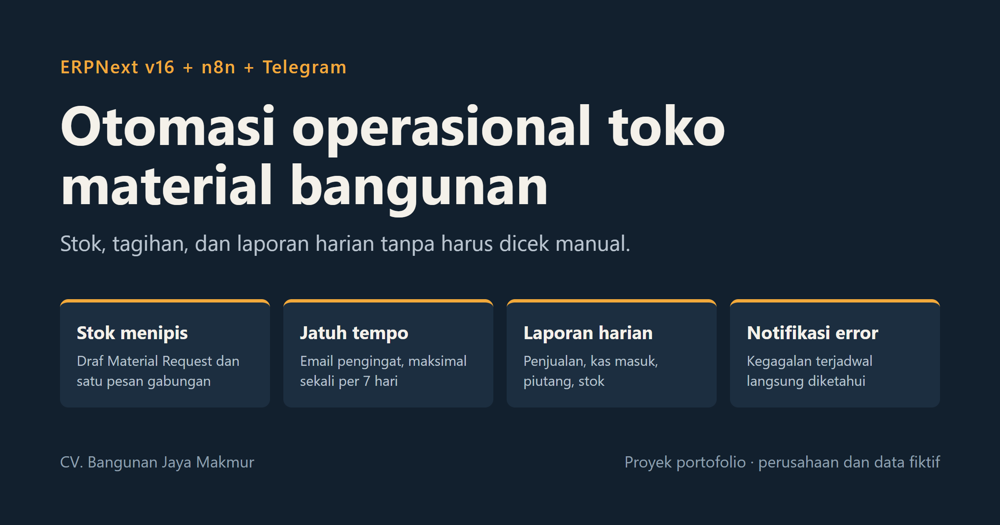
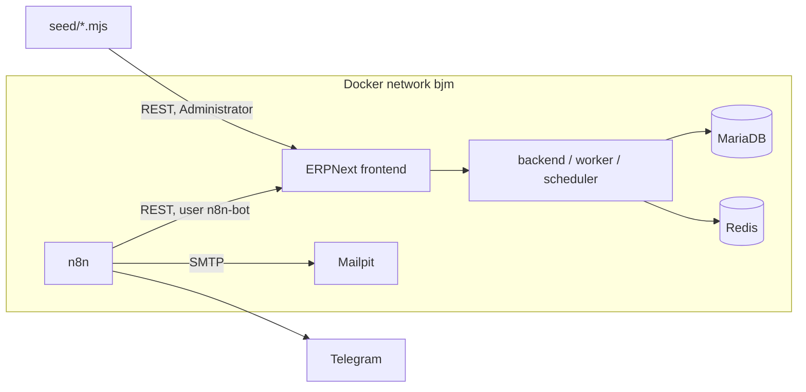
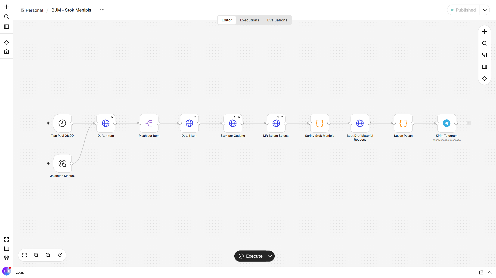
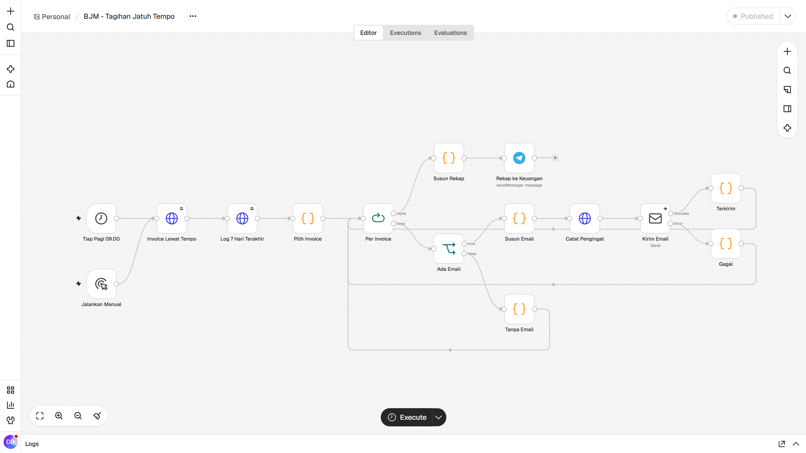
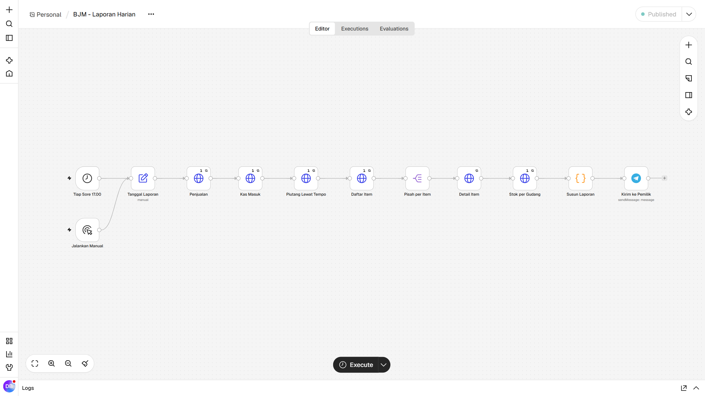
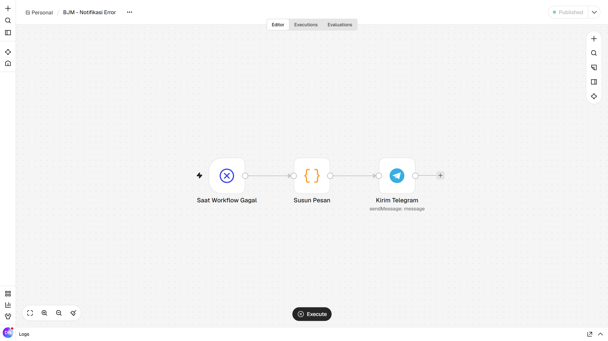
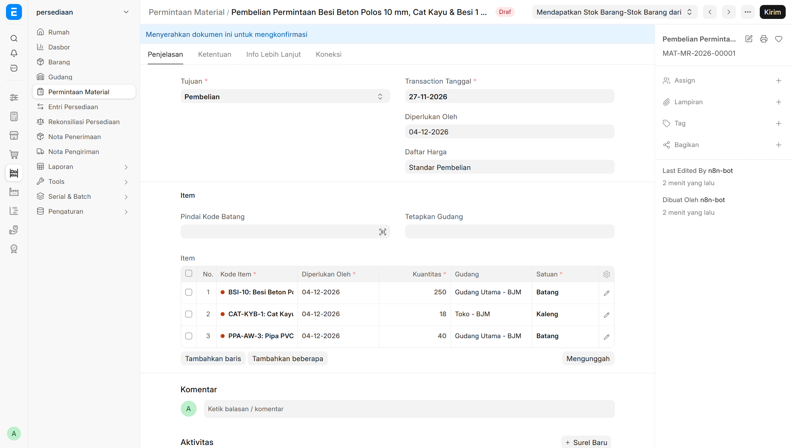
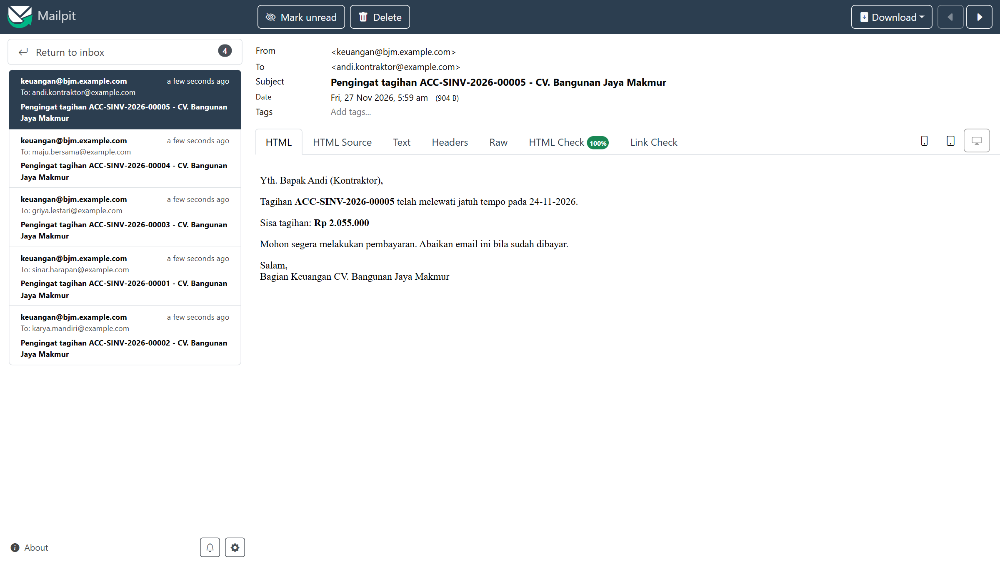

# ERPNext + n8n: CV. Bangunan Jaya Makmur

Otomasi operasional toko material bangunan **fiktif**. Semua nama, email, dan angka adalah data contoh.



**Status:** demo lokal, belum di-deploy. Diuji pada 27 November 2026 dari salinan repo yang bersih: setup empat perintah, hak akses user API, stok menipis, pengingat tagihan (Mailpit), dan laporan harian yang dicocokkan dengan laporan ERPNext termasuk retur dan dokumen batal. Notifikasi error diuji pada eksekusi terjadwal.

## Masalah

| Masalah | Otomasi |
|---|---|
| Stok menipis baru ketahuan saat barang habis | Tiap pagi 08.00: **satu** draf Material Request dan **satu** pesan Telegram |
| Tagihan jatuh tempo lupa ditagih | Tiap pagi 09.00: email ke pelanggan (maksimal sekali per 7 hari) dan rekap ke keuangan |
| Pemilik tidak tahu kondisi hari ini | Tiap sore 17.00: penjualan, kas masuk, piutang lewat tempo, stok di bawah batas |
| Otomasi gagal tanpa ada yang tahu | Notifikasi Telegram berisi workflow, node, dan pesan error |

## Arsitektur



ERPNext v16.61.0, n8n 2.49.7, MariaDB 11.8, Redis 6.2. Zona waktu `Asia/Makassar` di ERPNext dan n8n.

## Menjalankan

Butuh Docker (Compose v2), Node.js 20 atau lebih baru, dan Python 3 untuk alat uji workflow.

```bash
node seed/init-env.mjs          # membuat .env dengan password acak
docker compose --env-file .env -f docker/compose.yaml up -d
node seed/index.mjs             # setup company, user API, data contoh (tunggu beberapa menit)
node n8n/import.mjs             # credential dan workflow n8n
```

| Layanan | Alamat | Login |
|---|---|---|
| ERPNext | http://localhost:8081 | `Administrator` / `ADMIN_PASSWORD` di `.env` |
| n8n | http://localhost:5678 | akun owner dibuat saat pertama dibuka |
| Mailpit | http://localhost:8025 | kotak uji email, tidak ada email yang keluar |

Port bisa diubah di `.env`. Untuk menjalankan salinan kedua berdampingan, isi `COMPOSE_PROJECT_NAME` (nama lain) di `.env` salinan itu, lalu ganti `ERPNEXT_PORT`, `ERPNEXT_PUBLIC_URL`, `N8N_PORT`, dan `MAILPIT_PORT`.

### Telegram

1. Buat bot lewat @BotFather, isi `TELEGRAM_BOT_TOKEN` di `.env`.
2. Buat grup uji, tambahkan bot, kirim `/start@NamaBotKamu` di grup. Bot tidak membalas; ia hanya mengirim notifikasi.
3. `node n8n/telegram-chat-id.mjs --simpan`
4. `node n8n/import.mjs` (mengaktifkan workflow terjadwal).

Rekap tagihan dan laporan harian bisa diarahkan ke grup lain lewat `TELEGRAM_FINANCE_CHAT_ID` dan `TELEGRAM_OWNER_CHAT_ID`.

### Menguji

```bash
node seed/verify.mjs                          # ringkasan data
node seed/test-api.mjs                        # hak user n8n-bot
python n8n/run-workflow.py                    # jalankan stok menipis, ringkas hasil tiap node
python n8n/run-workflow.py bjmTagihan000001   # pengingat tagihan
python n8n/run-workflow.py bjmLaporanHari01   # laporan harian
node seed/stock.mjs SMN-PC-50 utama 40        # buat stok menipis
node seed/stock.mjs reset                     # stok awal, hapus Material Request
node seed/uji-tagihan.mjs                     # pengingat tagihan lewat Mailpit (menghapus log pengingat)
node seed/uji-laporan.mjs                     # cocokkan laporan harian dengan laporan ERPNext
```

`uji-laporan.mjs` mengirim beberapa pesan ke grup Telegram dan meninggalkan workflow *UJI - Laporan Harian* (tidak aktif) di n8n; hapus lewat editor bila perlu.

`uji-laporan.mjs --transaksi-uji` juga menguji retur dan pembatalan, tetapi meninggalkan dokumen yang tidak bisa dihapus. Jalankan hanya di instance uji.

## Tampilan

| Stok menipis | Tagihan jatuh tempo |
|---|---|
|  |  |
| **Laporan harian** | **Notifikasi error** |
|  |  |
| **Draf Material Request** | **Email pengingat** |
|  |  |

Skenario video demo: [docs/demo.md](docs/demo.md).

## Struktur

```
docker/compose.yaml         stack ERPNext, n8n, Mailpit
seed/                       setup, data contoh, user API, alat uji
n8n/build-workflows.py      sumber workflow
n8n/workflows/*.json        hasilnya, yang diimpor ke n8n
n8n/import.mjs              memasang credential dan workflow
docs/                       skenario demo dan screenshot
```

## Keputusan teknis

- **Kenapa n8n, bukan auto reorder bawaan ERPNext?** ERPNext v16 masih punya fitur itu, dan setup wizard-nya **menyalakannya** secara otomatis. Skrip setup mematikannya agar tidak bentrok. n8n dipilih untuk satu pesan gabungan di Telegram, aturan yang mudah diubah, dan alur lanjutan seperti persetujuan.
- **Aturan stok:** dipesan bila `projected_qty <= reorder_level`, sama dengan ERPNext. Barang tanpa baris `Bin` dianggap stok 0.
- **Anti dobel stok:** pasangan barang + gudang yang sudah ada di Material Request draf atau belum selesai dilewati.
- **Anti dobel email:** pengingat dicatat di DocType `Log Pengingat Tagihan` **sebelum** email dikirim. Bot tidak perlu izin tulis ke Sales Invoice.
- **Hak minimal:** `n8n-bot` hanya membaca data yang perlu, membuat Material Request, dan membuat log pengingat. Tidak bisa mengubah atau menghapus.
- **Laporan:** retur bernilai negatif ikut dihitung; dokumen batal tidak.
- **Retry** hanya pada request baca. Pembuatan dokumen dan pengiriman email tidak diulang otomatis.
- **Rahasia** hanya di `.env`. Credential diimpor ke n8n lewat stdin.
- **`encryption_key`** site dibuat saat `create-site`. Tanpa itu, beberapa proses bisa menulis kunci berbeda dan API secret gagal didekripsi.

## Keterbatasan

- Hanya untuk lokal/demo (diturunkan dari `pwd.yml` frappe_docker), bukan produksi.
- Jadwal hanya berjalan selama komputer dan Docker menyala.
- `N8N_BLOCK_ENV_ACCESS_IN_NODE=false` supaya chat ID tidak ikut di JSON workflow; akibatnya workflow bisa membaca env container n8n.
- Email yang gagal dikirim tidak diulang selama 7 hari; ia muncul di rekap Telegram agar ditindaklanjuti.
- Bila pesan Telegram gagal setelah Material Request dibuat, run berikutnya melewati barang itu, jadi pesannya tidak dikirim ulang. Notifikasi error juga lewat Telegram.
- **Kas masuk** hanya menghitung Payment Entry tipe Receive. Pembayaran langsung di invoice POS dan Journal Entry tidak ikut.
- **Piutang** dihitung dari sisa tagihan invoice; uang muka yang belum dialokasikan tidak dikurangkan.
- Rekap tagihan hanya dikirim bila ada invoice yang diproses. Hari tanpa yang perlu diingatkan tidak menghasilkan pesan.
- **Retur** di ERPNext tercatat sebagai nota kredit terpisah. Sampai direkonsiliasi (Payment Reconciliation), sisa tagihan invoice asli tidak berkurang, sehingga email pengingat masih menyebut jumlah penuh. Di laporan, nota kredit baru mengurangi piutang lewat tempo setelah tanggal jatuh temponya sendiri lewat.
- Angka stok di laporan adalah kondisi saat laporan dikirim.
- Link di pesan Telegram mengarah ke `localhost`, hanya bisa dibuka dari komputer yang menjalankan stack.
- `node n8n/import.mjs` menimpa workflow di n8n dengan isi `n8n/workflows/`. Export dulu perubahan yang dibuat lewat editor.
